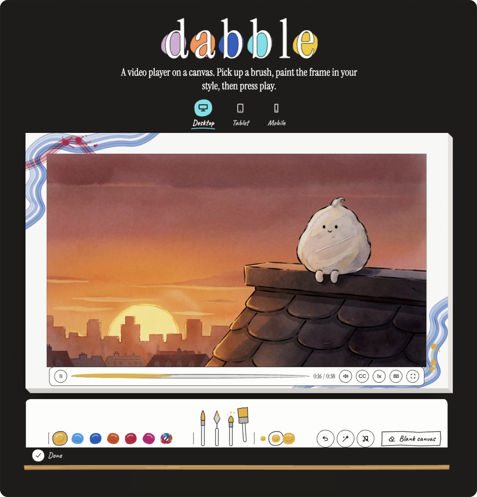

# Dabble, a Video.js v10 skin

A video player on a canvas. Viewers paint the frame around the video.



[Live demo](https://dabblevideo.com) · [Video.js v10 Skins Design Challenge](https://contra.com/community/topic/videojsskinschallenge) · [GitHub](https://github.com/milenawebb/dabble-skin)

In use on a live site: https://milenawebb.com/#dabble

## Where the skin is

The skin lives in `src/dabble/`. The demo landing page lives outside that folder. The remaining root files provide project tooling and hosting. Import the skin only through `src/dabble/index.ts`. It has no imports from the landing page or other app folders.

## Use it

This is a React 19 player using `@videojs/react` 10.3.0 and its packaged video preset. The folder includes its own buttons, frame styles, painting, captions, sounds and tests. The skin relies on a small patch to `@videojs/core` 10.3.0 in `patches/`, applied automatically by Bun through the `patchedDependencies` entry in `package.json`. It keeps the control bar visible while the video is paused or ended, hides it at once when the pointer leaves the player, and preserves caption intent. Keep both the patch and the `patchedDependencies` entry.

```tsx
import { DabblePlayer, type DabblePlayerProps } from './src/dabble';

const player: DabblePlayerProps = {
  playbackId: 'AAprZsIykh7T29gtsNk02YhBrQRHXTj14ZxbWdc498wA',
  poster: 'https://image.mux.com/AAprZsIykh7T29gtsNk02YhBrQRHXTj14ZxbWdc498wA/thumbnail.jpg?time=9&width=1280',
  captions: {
    src: '/captions/dabble-dab.en.vtt',
    srcLang: 'en',
    label: 'English',
  },
};

export function Example() {
  return <DabblePlayer {...player} />;
}
```

The import above assumes your example is at the repository root. Inside this demo, use `@/dabble`. The CSS is imported automatically. Host your caption file in your site's public folder. Load Instrument Serif, DM Sans and Caveat, as the demo does, or use the font variables below. The shared button styles use Tailwind CSS v4 utilities, already enabled in this project; another host must include the skin folder in its Tailwind source scan.

| Prop | Default | What it does |
| --- | --- | --- |
| `playbackId` | Not supplied | Public Mux playback ID. Takes priority over `src` and identifies saved paintings. |
| `src` | `''` | Direct video URL when no Mux ID is supplied. Cross-origin video needs permission for color sampling. |
| `poster` | Not supplied | Image shown before play. |
| `captions` | Not supplied | One track with `{ src, srcLang, label }`. Explicit VTT disables generated HLS subtitle formats. |
| `paintable` | `true` | Shows viewer painting tools. |
| `painting` | Not supplied | Starting `{ version: 1, palette, strokes }` painting. Stored viewer paintings take priority. Each stroke retains its own chosen colors. |
| `ownerTools` | `false` | Adds Copy painting code to the desktop/tablet tray. |
| `sounds` | `false` | Compatibility prop. It does not enable sound or hide the toggle; explicit viewer consent controls sound. |
| `defaultTrayOpen` | `false` | Starts the desktop/tablet tray open when true. Phones always start with watching controls and the tray closed. |
| `thumbnailSampleTimes` | Not supplied | Mux thumbnail times in seconds. Otherwise uses 15%, 35%, 55% and 75% of duration. |
| `onPaletteChange` | Not supplied | Receives the six current paint colors. |
| `onSoundPreferenceChange` | Not supplied | Receives the viewer's sound opt-in state. |
| `broken` | `false` | Deliberate broken-source test, not needed for normal use. |

Paintings use normalized points, fixed seeds and per-stroke palettes, so they redraw at any size. The tray's scene colors button takes a new palette from the current video frame. Browser storage is optional. Fresh visitors start silent; explicit sound consent is remembered. No private Mux credentials or Mux analytics are used.

## Controls and painting

On phones (player width under 420px), controls sit inside the video. Play and pause sit in the center, or in the bottom strip when the video is less than 180px tall. Speed, CC and mute sit in the top-right corner; time, seek and fullscreen sit in a slim bottom strip. Speed choices replace the top buttons with one row inside the video. Controls show on tap and hide after 2 seconds of idle while playing. They stay visible before first play, while paused or ended, during seeking, and while speed choices are open.

On desktop and tablet, the control bar sits fully inside the video and hides after 2 seconds of idle while playing. The paint tray stays a compact centered group at every width, with 12px between items and 28px between groups. It uses three rows below 670px, two zones from 670px until the complete row fits at 1192px, and one row above that. The content group is capped at 1170px; extra tray width stays on its sides.

On phones, paint is clipped to the canvas rectangle. A captured stroke continues outside the canvas invisibly and reappears when the finger returns. Page scrolling is blocked during a stroke and restored when the finger lifts. Desktop and tablet painting behavior is unchanged.

## Customize

Defaults live in `canvas.css` and `dabble-skin.css`. Colors below are their equivalent hex values. Keep readable contrast when changing them.

| CSS variable | Default | Changes |
| --- | --- | --- |
| `--dabble-paper` | `#FDFDFB` | Control and caption paper. |
| `--dabble-ink` | `#1B1B1A` | Text and outlines. |
| `--canvas-surface` | `#FDFDFB` | Canvas paper. |
| `--dabble-caption-text` | `var(--dabble-ink)` | Caption text. |
| `--dabble-caption-shadow` | `drop-shadow(0 2px 6px rgba(0, 0, 0, .18))` | Soft caption shadow. |
| `--dabble-video-pencil` | `color-mix(in srgb, var(--dabble-ink) 30%, transparent)` | Video outline. |
| `--dabble-video-shadow` | `0 1px 3px oklch(0 0 0 / .12)` | Video shadow. |
| `--dabble-ui-font` | `'DM Sans', Arial, sans-serif` | UI and captions. |
| `--dabble-label-font` | `'Instrument Serif', Georgia, serif` | Time, controls and panel titles. |
| `--dabble-hand-font` | `'Caveat', cursive` fallback | Blank canvas tag. Other handwritten labels use Caveat directly. |
| `--shelf-wood` | `#C99A5B` | Wooden ledge. |
| `--shelf-wood-shade` | `#A97B40` | Ledge shading. |
| `--shelf-wood-grain` | `#7A4E22` | Wood grain. |
| `--dabble-ledge-text` | `#C9C5BD` | Desktop/tablet ledge invitation. |

Override variables on the elements that use them. `--dabble-paper`, `--dabble-ink` and the two primary font variables have local defaults on `.dabble-skin`; override them there as well as on your host. Tray and canvas defaults inherit from the host. Avoid overriding measured geometry variables. Seek and button paint colors follow the sampled video palette; supply a `painting` with your own stroke colors for a branded starting frame.

## Accessibility

- Every control works with the keyboard. Escape closes menus.
- Two-tone focus rings show keyboard focus.
- Opaque paper controls remain readable over video and paint.
- On desktop and tablet the control bar sits inside the video, along its bottom edge, and hides after 2 seconds of idle while playing. It never covers the painted frame.
- Captions have an outlined paper label, with native fullscreen handover on iOS.
- Phone controls have touch targets at least 44 pixels tall. Speed choices share the available width and may be narrower on small videos.
- Phone speed choices have radio semantics; Escape, Close speed, or a tap elsewhere on the video closes the row.
- Reduced motion disables fades and slides. Forced colors use system colors.

## Run it locally

Install Bun, then:

```sh
git clone https://github.com/milenawebb/dabble-skin.git
cd dabble-skin
bun install
bun run dev
```

Open the local URL printed by Vite. Other commands:

```sh
bun run test
bun run build
bun run preview
```

## Credits

Built on Video.js v10. Demo film made for this project, hosted on Mux. Made by Milena Webb.

## License

Apache License 2.0. See [LICENSE](LICENSE).
